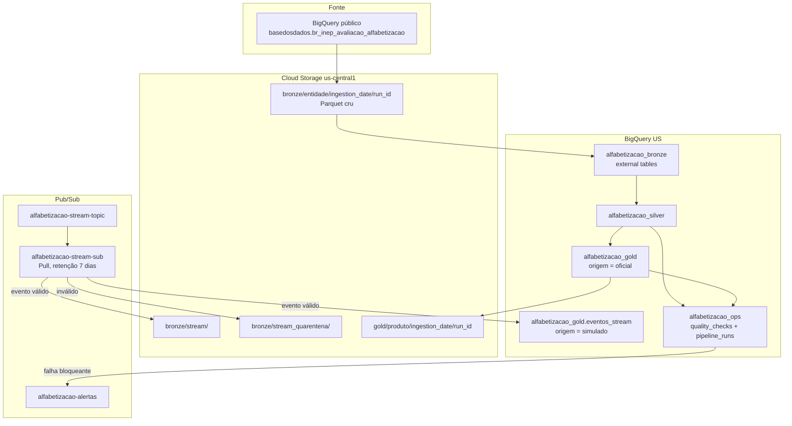

# Tech Challenge — Fase 2: Pipeline híbrido de alfabetização

**Pós-graduação:** POSTECH — AI Scientist (IAST) | **FIAP**  
**Cloud:** Google Cloud Platform, região do lake `us-central1`, BigQuery em `US`

Pipeline batch + streaming sobre o indicador de alfabetização do Inep (Base dos Dados), em arquitetura Medalhão. A comparação de cada passo com o enunciado está em [`docs/avaliacao_conformidade.md`](docs/avaliacao_conformidade.md). O guia de construção é [`docs/Tech_Challenge_Fase2_Passo_a_Passo.md`](docs/Tech_Challenge_Fase2_Passo_a_Passo.md).

---

## Contexto

O [Compromisso Nacional Criança Alfabetizada](https://www.gov.br/inep/pt-br/areas-de-atuacao/avaliacao-e-exames-educacionais/avaliacao-da-alfabetizacao) reúne União, estados, Distrito Federal e municípios em torno de uma meta: toda criança alfabetizada até o fim do 2º ano do ensino fundamental. O Inep fixou o padrão nacional em **743 pontos** na escala de proficiência do Saeb. O Indicador Criança Alfabetizada é o percentual de estudantes que chegaram nesse ponto.

Neste repositório a meta **pactuada** é a coluna `meta_alfabetizacao_2030`. Na rede pública ela vale **80**. Outra coluna, `percentual_participacao`, é participação/universalização e não entra no status. As metas intermediárias (`meta_alfabetizacao_2024` = 59,9 no Brasil, e as dos anos seguintes) estão na Bronze e na Silver; o produto Gold compara o resultado com 80.

O microdado já traz a flag `alfabetizado`. Na Silver da run de referência, quem tem flag `1` está todo com proficiência ≥ 743 (mínimo 743,00; 1.984.546 alunos). Quem tem flag `0` e nota preenchida não tem nenhum caso ≥ 743. Ausente (512.153) não tem nota. O pipeline não recalcula o corte: usa a flag do Inep no microdado e a `taxa_alfabetizacao` oficial nos agregados. A conta está em [`evidence/passo_10/insights_consultas.md`](evidence/passo_10/insights_consultas.md).

Números oficiais que a Gold reproduz (run `20d3623d0430`):

| Recorte | Taxa | Meta 2030 | Status |
|---------|------|-----------|--------|
| Brasil, 2024, rede pública | 59,2 | 80 | `nao_atingiu` (gap −20,8 pp) |
| Ceará, 2024, rede pública (`rede = 5`) | 85,31 | 80 | acima da meta; única UF nesse recorte |

Em 2024, 1.141 de 5.448 municípios da rede municipal atingiram 80 (21%). Em 2023 eram 935 (17%).

---

## Arquitetura proposta

Lakehouse híbrido (**Lambda** + **Medalhão**), em **ELT**. O diagrama é o que rodou no GCP (run `20d3623d0430`): batch do histórico oficial e um evento simulado ao lado, sem Spark, Kafka nem orquestrador.



**Batch.** A fonte pública vai para Parquet cru no GCS, um `run_id` por execução. `alfabetizacao_bronze` é external table desse path. A Silver tipa, traduz código e junta fato com meta em SQL (não há pasta `silver/` no bucket). Se o `join_match` ficar abaixo de 0,95, o job para. A Gold publica os cinco produtos com `origem = oficial` e exporta Parquet para `gold/`.

**Stream.** O produtor manda um JSON fictício ao Pub/Sub. Evento válido cai em `bronze/stream/` e em `eventos_stream` (`origem = simulado`); inválido vai para a quarentena; duplicata não soma de novo. A taxa oficial permanece intacta.

**Controle.** `quality_checks` e `pipeline_runs` só recebem append. Falha bloqueante aparece no terminal, encerra com exit diferente de zero e publica o JSON em `alfabetizacao-alertas` para um assinante futuro. A ordem das etapas é a dos comandos deste README.

---

## Tecnologias

| No repositório | Fora desta entrega |
|----------------|--------------------|
| Python 3.14, pandas e PyArrow só na borda (evidência, tipos) | Spark / cluster |
| BigQuery (extração, Silver, Gold, checagens) | Orquestrador (Airflow, Composer) e Terraform |
| Cloud Storage, Parquet particionado | Kafka ligado 24/7 |
| Pub/Sub (evento simulado e alerta) | Banco vetorial |
| Scripts na ordem deste README | Projeção / cenário até 2030 |

O que está na coluna da esquerda já cobre o padrão da aula. A coluna da direita repete o mesmo papel com mais máquina, e neste volume não muda o resultado.

- **Spark** ensinaria o Medalhão. O padrão está em SQL no BigQuery. Cerca de 3,8 milhões de alunos cabem numa query que liga e desliga; um cluster ficaria ligado e sairia do free tier.
- **Kafka** ensinaria produtor, tópico, consumidor, duplicata e dois relógios. O Pub/Sub já faz isso. Um broker 24/7 para uma demo de 20 mensagens é custo contínuo.
- **Terraform e orquestrador** criariam a infra e o agendamento. Bucket, tópico e subscription nascem uma vez; os datasets nascem nos scripts. A reprodução é a sequência de comandos, não um DAG.
- **Banco vetorial** serviria, depois, para achar municípios de trajetória parecida em `indicador_municipio`. Esta fase entrega a tabela.

---

## Decisões arquiteturais

Quatro trade-offs do que rodou. O detalhe de Spark, Kafka e orquestrador está em Tecnologias.

### Batch versus streaming

Os dois convivem (Lambda). O batch responde ao histórico oficial; o stream só prova a camada rápida. O evento é simulado e não regrava a taxa com `origem = oficial`.

| | Batch | Stream |
|--|--------|--------|
| O que carrega | As seis entidades + `dicionario`, a run inteira | Um JSON de indicador municipal |
| Latência | Silver medida em ~56 s; a carga completa é da ordem de minutos | 7–24 s entre `produced_at` e `ingested_at` na demo |
| Frequência | Quando o script roda | Uma mensagem por evento |
| Garantia | Snapshot daquela `run_id`; a run anterior permanece no bucket | *At-least-once*; duplicata não soma `valor` de novo |
| Onde mora | `alfabetizacao_gold` com `origem = oficial` | `eventos_stream` com `origem = simulado` |

Um pipeline só batch perderia a mensageria da aula. Um pipeline só stream não tem feed do Inep e não reconstrói o país.

### Data lake versus data warehouse

Os dois. O lake guarda arquivo; o warehouse responde em SQL.

| | Lake (Cloud Storage) | Warehouse (BigQuery) |
|--|----------------------|----------------------|
| O que é | Parquet cru em `bronze/<entidade>/ingestion_date/run_id` e o export da Gold em `gold/` | `alfabetizacao_bronze` (external table), Silver e Gold nativas |
| Papel | Histórico. Uma run nova não apaga a anterior | Pergunta: tipo, join com a meta, indicador, evolução |
| Silver | Não há pasta `silver/` | Tabela particionada por `ano` |

ELT de propósito: a Bronze não aplica regra de negócio. Limpar no pandas obrigaria a baixar 3,8 milhões de alunos. A anomalia de `rede` (código no fato, rótulo na meta) só é resolvida na Silver, com de-para `3` ↔ `Municipal` e `5` ↔ `Pública`.

### Custo versus performance

A meta é caber no Always Free, não ser o mais rápido possível. Por isso o motor é SQL serverless (job liga e desliga), Parquet comprimido, partição por `run_id` e por `ano`, e só as colunas do contrato na extração.

O que se mede: a Silver leva ~56 s; no `dry_run` da Gold, a validação do microdado concentra ~195 MiB dos ~202 MiB. Na cadência de 1 batch/dia, a projeção fica em ~0,021 TiB/mês, dentro de 1 TiB gratuito ([`evidence/passo_09/custo.md`](evidence/passo_09/custo.md)).

O que se abre mão: latência de segundos no indicador oficial, e um cluster sempre ligado. Se o microdado deixar de caber na cota, o caminho é Spark — não é o caso desta carga.

### Forma de acesso à fonte

A fonte já está no BigQuery público (`basedosdados.br_inep_avaliacao_alfabetizacao`). O batch faz `EXPORT DATA` das colunas do contrato direto para o GCS, na mesma nuvem. Não há download do país para o notebook, nem `SELECT *`, nem egress entre nuvens: o dado não sai do GCP. O bucket está em `us-central1` e o BigQuery em `US`; essa região fica dentro da multi-região, então a gravação no lake não abre uma segunda conta de rede.

O byte cobrado nesse acesso é o da query. Na run `20d3623d0430` o export leu **271.547.681** bytes (alunos sozinho, 268.545.240). Cabe no 1 TiB gratuito do Always Free.

A Base dos Dados pode publicar uma versão nova. Este repositório não busca isso sozinho: não há agenda nem DAG. A cópia no lake só muda quando alguém roda `python bronze/ingest_batch.py` de novo. Essa execução cria outro `run_id` e não apaga a anterior. As duas já convivem no bucket: `f92c40cfe9a7` e `20d3623d0430`, no mesmo `ingestion_date`. O custo se repete — outro scan das colunas do contrato, mais uma partição Parquet — e, no volume medido, continua dentro da cota.

O `EXPORT` lista os nomes de [`docs/contrato_dados.md`](docs/contrato_dados.md). Se a fonte renomear ou retirar uma dessas colunas, a query falha, o script sai com exit diferente de zero e a run anterior permanece. Uma coluna nova que a fonte acrescente e o contrato não liste não entra no Parquet e não derruba o job; ela só passa a ser extraída quando entrar no contrato e na lista de `bronze/ingest_batch.py`.

---

## Clone limpo

Testado o contrato dos comandos contra os scripts deste repositório. Um segundo projeto GCP não foi criado aqui: a prova de que o caminho produz Gold e consome evento é a run `20d3623d0430`, em `evidence/`. Um clone novo gera outro `run_id`.

### 1. Máquina

- Python **3.14** (o ambiente das evidências é 3.14.7)
- Git
- Conta GCP com faturamento (o uso deste desenho cabe no Always Free; o alerta de R$ 1,00 é o freio)
- [Google Cloud SDK](https://cloud.google.com/sdk) se for criar bucket e tópico pela linha de comando

### 2. Código e ambiente

```bash
git clone https://github.com/Cleivin/tc-postech-fiap.git
cd tc-postech-fiap
```

**Windows (PowerShell):**

```powershell
python -m venv .venv
Set-ExecutionPolicy -Scope Process -ExecutionPolicy Bypass
.\.venv\Scripts\Activate.ps1
python -m pip install --upgrade pip
pip install -r requirements.txt
Copy-Item .env.example .env
```

**macOS / Linux:**

```bash
python3 -m venv .venv
source .venv/bin/activate
python -m pip install --upgrade pip
pip install -r requirements.txt
cp .env.example .env
```

Edite `.env`:

```env
GCP_PROJECT_ID=seu-projeto-gcp
GCP_BUCKET_NAME=seu-bucket-datalake
GOOGLE_APPLICATION_CREDENTIALS=credentials/gcp-sa-key.json
GCP_LOCATION=us-central1
BIGQUERY_LOCATION=US
```

A chave JSON da service account fica em `credentials/gcp-sa-key.json`. `.env` e `credentials/*.json` não entram no Git.

A conta de serviço precisa conseguir: rodar query no BigQuery (inclusive no dataset público), criar dataset e tabela, ler e gravar objetos no bucket, publicar e fazer pull no Pub/Sub, e criar o tópico de alerta.

### 3. Recursos que o script não cria

O código cria os datasets `alfabetizacao_bronze`, `alfabetizacao_silver`, `alfabetizacao_gold` e `alfabetizacao_ops`. Também cria `alfabetizacao-alertas` na primeira falha do Passo 8.

Estes quatro ficam a cargo de quem clona (console ou `gcloud`):

```bash
gcloud storage buckets create gs://SEU_BUCKET --location=us-central1 --uniform-bucket-level-access
gcloud pubsub topics create alfabetizacao-stream-topic --project=SEU_PROJETO
gcloud pubsub subscriptions create alfabetizacao-stream-sub \
  --topic=alfabetizacao-stream-topic \
  --ack-deadline=60 \
  --message-retention-duration=7d \
  --project=SEU_PROJETO
```

No console de billing, crie um orçamento com alerta em **R$ 1,00**. Sem isso o pipeline roda, mas o freio do Passo 1 não existe.

### 4. Da conexão até a Gold e um evento

Com a `.venv` ativa, na raiz do repositório:

```powershell
python test_gcp_connection.py
python bronze/ingest_batch.py
python quality/validate.py --layer bronze
python silver/transform.py
python quality/validate.py --layer silver
python gold/build.py
python streaming/producer.py --n 20
python streaming/consumer.py
```

Saída esperada: `[OK]` no teste (exit 0), validate Bronze e Silver com exit 0, Gold com exit 0. O producer publica 18 eventos válidos, 1 inválido e 1 duplicata. O consumer precisa rodar **depois**, enquanto a subscription ainda tem essas mensagens: 18 inserts, 1 duplicata ignorada, 1 arquivo em `bronze/stream_quarentena/`, latência > 0. A taxa oficial não muda.

Opcional, na mesma ordem do guia:

```powershell
python quality/prove_failure.py
python ops/prove_observability.py
python ops/finops_snapshot.py
```

Os dois primeiros **terminam com exit 1** de propósito (falha bloqueante provocada). O terceiro regrava [`evidence/passo_09/custo.md`](evidence/passo_09/custo.md).

Não passe `--run_id` se quiser a última Bronze. O `run_id` impresso pela ingestão é o que Silver e Gold usam quando o parâmetro vem vazio.

---

## Monitoramento

Cada etapa instrumentada faz **append** em `alfabetizacao_ops.pipeline_runs` (`run_id`, duração, linhas, status, bytes; stream também grava latência mínima, máxima e média).

Uma falha bloqueante aparece no terminal e encerra com exit diferente de zero. Quem descobre é quem executou o comando, no mesmo processo, em segundos. Na prova do Passo 8, esse script encerrou em 0,57 s (`prove_fail_81ee7cf0f8ea`). O registro que sobrevive à sessão é a linha `failed` em `pipeline_runs`. Prova: `python ops/prove_observability.py` e [`evidence/passo_08/`](evidence/passo_08/).

E-mail, Slack ou política de alerta entram na etapa em que a pipeline rodar sem um operador na sessão. O tópico `alfabetizacao-alertas` já recebe o JSON dessa falha para esse assinante futuro; hoje não há subscription nele. O e-mail de orçamento de R$ 1,00 continua sendo só o freio de custo.

Na fotografia do Passo 9, `pipeline_runs` tem a etapa Silver (duas linhas `success`, ~56 s e ~58 s, 276.408.457 bytes) e a falha provocada. Bytes de Bronze e de Gold usados na conta vieram dos manifests e do `dry_run`, não dessa tabela.

## FinOps

`python ops/finops_snapshot.py`. Preços públicos consultados em **2026-10-18**. Premissa da projeção: **1 batch/dia** e **1.000 eventos/dia**. A execução atual e essa cadência ficam dentro do Always Free. A coluna da direita é o custo **depois** de descontar a cota, não uma fatura.

| Serviço | Unidade | Quantidade medida | Preço unitário | Custo mensal projetado |
|---------|---------|-------------------|----------------|------------------------|
| Cloud Storage | GiB-mês | 0,192 GiB (135 objetos, API) | US$ 0,020 / GiB-mês | US$ 0,00 (5 GiB grátis) |
| BigQuery | TiB/mês | 0,0207 TiB (760.231.654 bytes/batch × 30) | US$ 6,25 / TiB | US$ 0,00 (1 TiB grátis) |
| Pub/Sub | GiB/mês | 0,013 GiB (média 240 B × 1.000 eventos/dia × 30 × 2) | US$ 40 / TiB | US$ 0,00 (10 GiB grátis) |
| Computação | segundos | 56,2 s na Silver medida; motor serverless | embutido em BigQuery / Pub/Sub | US$ 0,00 |

O que segura esse número: Parquet, partição por `ingestion_date`/`run_id` e por `ano`, colunas explícitas no export, bucket em `us-central1` com BigQuery em `US`, consumer que não fica ligado, SQL em vez de cluster.

Detalhe e premissa: [`evidence/passo_09/custo.md`](evidence/passo_09/custo.md).

---

## Aplicação em IA

A Gold é o terreno da Fase 3, em tabela e em Parquet (`gs://<bucket>/gold/`). Nenhum modelo foi treinado aqui. O que segue é o uso possível de cada produto, com `origem = oficial`. `eventos_stream` fica de fora: o `valor` é sorteado.

### Predição de alfabetização

O alvo é a `taxa_alfabetizacao` de um ano que ainda não está na linha, ou o fato de o município cruzar 80 (`status_meta` futuro). A unidade natural é `indicador_municipio` (município × ano × rede × série). Com só 2023 e 2024, o histórico cabe em `evolucao_temporal`: `taxa_anterior` e `delta_pp` do ano anterior entram como feature; a taxa do ano seguinte é o rótulo.

Candidatas que não são o rótulo: rede, série e a composição `proporcao_aluno_nivel_*` em 2024. Em 2023 essa composição veio inteira nula; preencher com zero diria que ninguém está no nível 0. Isto é trajetória observada, não o cenário até 2030 — essa tabela não foi construída.

### Desigualdade educacional

`indicador_uf` e `meta_vs_resultado` já medem a distância entre territórios, sem modelo. Em 2024, na rede pública, o Ceará está em 85,31 e a Bahia em 35,96 — quase 50 pp no mesmo indicador. No município de rede 3, 1.141 de 5.448 atingiram 80 (21%); a média de quem não atingiu é 55,2. As 242 linhas `sem_meta` têm média 53,7: a lacuna de cadastro se parece com quem ficou abaixo da meta, não com quem já passou.

`validacao_microdado` serve de auditoria, não de segundo ranking. A diferença absoluta mediana contra a taxa oficial é 0,0037 pp. O alvo de qualquer comparação territorial continua sendo a taxa do Inep.

### Políticas públicas

A mesma Gold ordena onde agir. `gap_pp` e `status_meta` separam quem já chegou a 80, quem está longe e quem nem tem meta pactuada. `delta_pp` mostra a trajetória de um ano para o outro (Minas Gerais +12,26 pp; Rio Grande do Sul −18,76 pp na rede pública). Isso sustenta uma fila de prioridade — município, rede, série — e não uma estimativa do efeito de uma política. O pipeline não observa a intervenção, só o indicador.

### Vazamento de alvo

Numa base de features, a linha não pode trazer o alvo e uma coluna calculada a partir dele. O modelo acerta tudo e não aprendeu nada: basta inverter a fórmula.

Na Gold isso é direto. `gap_pp` é `taxa_alfabetizacao − meta_alfabetizacao_2030`. `status_meta` é a taxa comparada com 80 (`atingiu` / `nao_atingiu`), ou `sem_meta` quando falta taxa ou meta. Prever `status_meta` de 2024 tendo `gap_pp` de 2024, ou prever a taxa tendo o gap do mesmo ano, devolve o rótulo. `taxa_micro` no mesmo ano também vaza: ela reproduz a taxa oficial na mediana.

O que pode entrar como feature do ano que se quer prever é o passado (`taxa_anterior`, `delta_pp` de anos anteriores) e o contexto (rede, série, níveis de 2024). A meta 80 é a régua da política, constante onde existe; não substitui a taxa e não deve ser tratada como se fosse causa do resultado daquele ano.

---

## Limitações

Três origens diferentes. O que está fora por desenho não é lacuna da fonte, e o que a fonte não traz o pipeline preserva em vez de imputar.

### Decisão de arquitetura

O desenho cabe no Always Free: lake no GCS, transformação em SQL no BigQuery, evento no Pub/Sub, job que liga e desliga. O alerta de billing em R$ 1,00 é o freio se uma query sair da cota.

| Fora do repositório | Por quê |
|---------------------|---------|
| **Spark** | A aula ensina o Medalhão. O volume (~3,8 milhões de alunos) cabe em SQL serverless. Cluster ficaria ligado e sairia do free tier sem ganho analítico. Spark volta a fazer sentido se o microdado deixar de caber na cota. |
| **Kafka** | Pub/Sub cumpre produtor, tópico, consumidor, entrega *at-least-once*, duplicata e os dois relógios. Cluster 24/7, neste volume simulado, é custo contínuo. |
| **Terraform e orquestrador** | Bônus do guia. Bucket, tópico e subscription nascem uma vez (console ou `gcloud`); datasets e o tópico de alerta nascem nos scripts. A reprodução é a sequência de comandos deste README, não um DAG nem estado de infra. |
| **Banco vetorial** | Fora do escopo. Uso futuro: buscar municípios de trajetória parecida a partir de `indicador_municipio`. |
| **Cenário até 2030** | O guia permite a conta, com o nome de cenário. Não há tabela de projeção, para a reta não ser lida como previsão. |

### Limite da fonte

O Inep / Base dos Dados chega assim. A Bronze guarda o valor cru; a Gold não completa o que a fonte não publicou.

| O que aparece | Por que acontece | O que o pipeline faz |
|---------------|------------------|----------------------|
| Dois encodings de `rede` | Agregado usa código (`3`, `5`); meta usa rótulo (`Municipal`, `Pública`) | De-para na Silver, só esses dois pares. Igualdade direta de `rede` perde a meta. |
| ~3% `sem_meta` (242 linhas de rede 3: 146 em 2023, 96 em 2024) | A meta municipal não cobre todo o fato. Taxa média dessas linhas: 53,7, parecida com quem ficou abaixo de 80 | `LEFT JOIN` e status `sem_meta`. O gap permanece nulo. |
| RR, DF e AC | Meta de RR nula em 2023–2024. O agregado `uf` não traz RR nem DF em rede pública. AC entra nessa rede só em 2024 | A linha não é fabricada. |
| Brasil 2025 = 66,0 só na tabela de meta | O fato de UF vai até 2024 | O produto Brasil da Gold tem 2023 e 2024, os anos do lado esquerdo. |
| Níveis 0–8 nulos em 2023 | A composição por nível veio preenchida em 2024 (12.448 linhas) e vazia em 2023 (11.547) | Não vira zero. Zero diria que ninguém está no nível 0. |
| Rede privada: 25 alunos em 2024 | Quase não há microdado privado | A taxa (66,7% em 24 presentes) não entra em comparação. |

### Escopo desta entrega

- **Streaming simulado.** O Inep não publica este indicador em tempo real. O evento leva `origem = simulado` e não altera a taxa oficial.
- **Telemetria do Passo 9.** A duração em `pipeline_runs` nessa fotografia é a da Silver (~56 s). Bytes de Bronze e de Gold vieram do manifesto e do `dry_run`. O código já grava as outras etapas; essa run de referência foi medida antes dessas linhas existirem na tabela.
- **Vídeo.** O Passo 11 ainda não foi gravado. A seção seguinte reserva o link.

---

## Vídeo (Passo 11)

Ainda não gravado. Quando existir, o link entra aqui.

Roteiro previsto: o problema (2º ano, indicador, meta 80), a arquitetura em uma frase (batch histórico + evento simulado, Bronze → Silver → Gold no GCP), um número da Gold igual ao deste README (Ceará 2024, rede pública, 85,31, ou Brasil 2024, 59,2 contra meta 80), e o que a Fase 3 pode prever sem usar a taxa do mesmo ano como feature.

---

## Mapa do repositório

```text
tc-postech-fiap/
├── README.md                      # este arquivo
├── .env.example                   # variáveis; .env não sobe
├── requirements.txt               # versões pinadas com ==
├── test_gcp_connection.py
├── docs/
│   ├── contrato_dados.md
│   ├── avaliacao_conformidade.md  # pedido do challenge × o que foi feito
│   └── Tech_Challenge_Fase2_Passo_a_Passo.md
├── sql/          DECISOES.md      # perfil, exploração, Silver, Gold
├── bronze/       DECISOES.md
├── quality/      DECISOES.md
├── silver/       DECISOES.md
├── gold/         DECISOES.md
├── streaming/    DECISOES.md
├── ops/          DECISOES.md
└── evidence/
    ├── passo_01/ … passo_09/      # cada pasta tem ANALISE.md
    ├── passo_10/                  # este README e as consultas de leitura
    └── passo_11/                  # vídeo, ainda vazio
```

Contrato de grain, chave e limiar: [`docs/contrato_dados.md`](docs/contrato_dados.md).

---

## Problemas comuns

| Sintoma | O que fazer |
|---------|-------------|
| `python` não encontrado | Use `python3`, ou instale Python 3.14 e marque “Add to PATH” |
| PowerShell bloqueia a `.venv` | `Set-ExecutionPolicy -Scope Process -ExecutionPolicy Bypass` |
| `[FALHA]` no teste de conexão | Confira projeto, bucket, chave e se o tópico `alfabetizacao-stream-topic` existe. Exit 1 é o teste funcionando |
| `[AVISO]` sobre `alfabetizacao-alertas` | Normal antes do Passo 8. O tópico nasce na prova de observabilidade |
| Consumer recebe 0 mensagens | Rode o producer primeiro. A subscription é Pull; mensagem já confirmada (ack) não volta |
| `prove_failure` ou `prove_observability` saem com erro | Esperado. Exit 1 é o critério de pronto |
| Silver ou Gold vazias | A Bronze precisa ter terminado. Sem `--run_id`, os scripts usam a última `ingestion_ts` |
